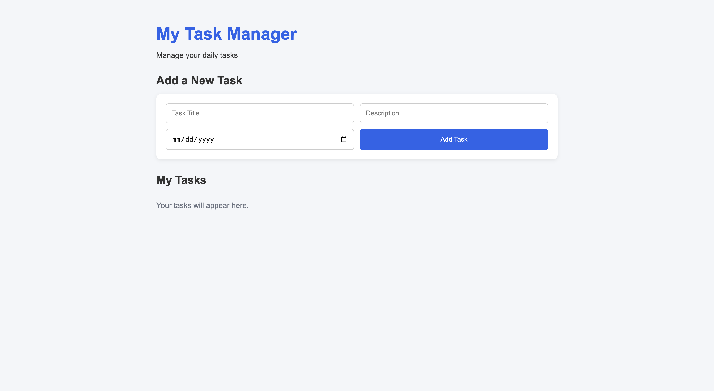

# Task Management Application

A full-stack task management application built using Java and Spring Boot. Users can create, view, complete, and delete tasks through a simple web interface.

The application uses a REST API to handle task operations and an H2 database to store task information across application restarts.

## Features

- Create tasks with a title, description, and due date
- View all saved tasks
- Mark tasks as completed
- Delete existing tasks
- Persist task data using an H2 database
- Responsive web interface

## Technologies Used

**Backend:** Java 21, Spring Boot, Spring Data JPA, REST API

**Frontend:** HTML, CSS, JavaScript

**Database:** H2

**Build Tool:** Maven

## API Endpoints

| Method | Endpoint | Description |
|---|---|---|
| GET | `/tasks` | Retrieve all tasks |
| POST | `/tasks` | Create a new task |
| PATCH | `/tasks/{id}/complete` | Mark a task as completed |
| DELETE | `/tasks/{id}` | Delete a task |

## How to Run

1. Clone the repository to your computer.
2. Make sure Java 21 is installed.
3. Open a terminal in the project directory.
4. Run `./mvnw spring-boot:run`.
5. Visit `http://localhost:8080/` in your browser.

The application runs locally on port 8080.

## How It Works

The frontend uses JavaScript's Fetch API to send HTTP requests to the Spring Boot backend.

The backend uses a controller to handle incoming requests and a service class to process task operations. Spring Data JPA communicates with the H2 database to save and retrieve task information.

Tasks are assigned unique database IDs, allowing them to be updated or deleted individually.

## Project Structure

- `Task.java` — Represents a task and its database fields
- `TaskController.java` — Handles REST API requests
- `TaskManager.java` — Contains task management logic
- `TaskRepository.java` — Provides database operations
- `TaskRequest.java` — Represents incoming task creation data
- `index.html` — Webpage structure
- `script.js` — Frontend functionality and API requests
- `styles.css` — User interface styling

## Future Improvements

- Task editing functionality
- Task priority levels
- Task filtering and sorting
- User authentication

## Application Screenshot

